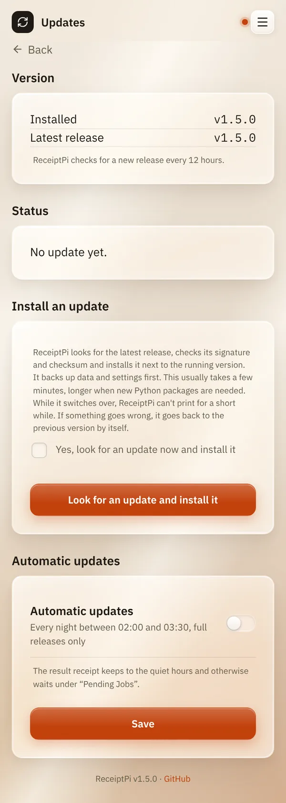

# Updates

*[Deutsche Version](updates.de.md)*

**Who:** admins

## What it does

Shows which ReceiptPi version runs and whether there is a newer one, and
installs it with one tap. ReceiptPi backs up your data and settings
first. If the new version doesn't start properly, it goes back to the
previous one by itself. If you like, it does all this at night without
you.

Only full releases are installed, no test versions. Every update is
signed: ReceiptPi only installs what really comes from the ReceiptPi
project.

## How to use it

### Installing an update

1. Open the menu (three lines at the top right), tap **Settings** and
   then **Updates**.
2. Under **Version** you see what is **Installed** and the **Latest
   release**.
3. Under **Install an update**, tick **Yes, look for an update now and
   install it**.
4. Tap **Look for an update and install it**.

   

5. Under **Status** you can follow the update. While ReceiptPi restarts,
   it says "ReceiptPi is restarting, this page comes back in a moment."
   When the update is done, the page reloads by itself.
6. A receipt shows the result, in German and English.

### Automatic updates

1. On the same page, under **Automatic updates**, switch on **Automatic
   updates**.
2. Tap **Save**.

ReceiptPi then looks for a new release every night between 02:00 and
03:30 and installs it.

## Good to know

- **Admins only, and only with an admin account.** As long as no admin
  account exists, the page says "Updates can only be installed once an
  admin account exists."
- **How long it takes:** usually a few minutes, longer when new Python
  packages are needed. While ReceiptPi switches over, it can't print for
  a short while.
- **Back up first, go back if needed.** Before switching, ReceiptPi saves
  your data, settings and accounts on the device. If the new version
  doesn't start properly, the previous version comes back with exactly
  this data. Anything printed in those few minutes may be missing from
  the history.
- **The receipt at night** keeps to your [quiet hours](print-rules.md).
  During quiet hours it waits under [Pending jobs](../modules/pending.md).
  After a tap on the button it prints right away.
- **The start receipt** ("server started") is not printed during an
  update; the result receipt replaces it.
- **Checking for new releases:** ReceiptPi checks every 12 hours, see
  [Automatic watchers](../integrations/watchers.md). A new release can be
  listed there a few minutes before its update package is ready.
- **Not on every installation.** On a device that wasn't installed from
  the image or with `deploy/install.sh`, the page says "Updates are
  installed by hand on this device. ..." and has no button.
- The technical details (signature, two-stage updater, way back over
  SSH) are in the [developer reference](../developer-reference.md#updates).

## Something not working?

| Problem | What to do |
|---------|------------|
| "No update package is available right now. Please try again later." | The release was just published, its package follows a few minutes later. Try again later. |
| "Reason: The download didn't work." | Is the device online? Does your network block `github.com` or `pypi.org`? Try again later. |
| "Reason: There is not enough space on the memory card." | Delete what you don't need on the device, or use a larger memory card. |
| "Reason: This release can't be installed automatically, it needs a manual installation." | Install it as described in [Installation](../installation.md#installing). |
| "Update to ... didn't work. ReceiptPi runs ... again, ..." | Nothing is lost: the previous version runs with your data. See the reason on the page; report it on [GitHub](https://github.com/HostisHumani/ReceiptPi/issues) if it happens again. |
| "... and neither did going back to ..." | See [Troubleshooting](../help/troubleshooting.md#an-update) for the way back over SSH. |
| The page shows "Test mode: ..." | This device accepts test packages. Delete `/etc/receiptpi/update.conf` (terminal: `sudo rm /etc/receiptpi/update.conf`). |

---

[Back to the overview](../README.md)
